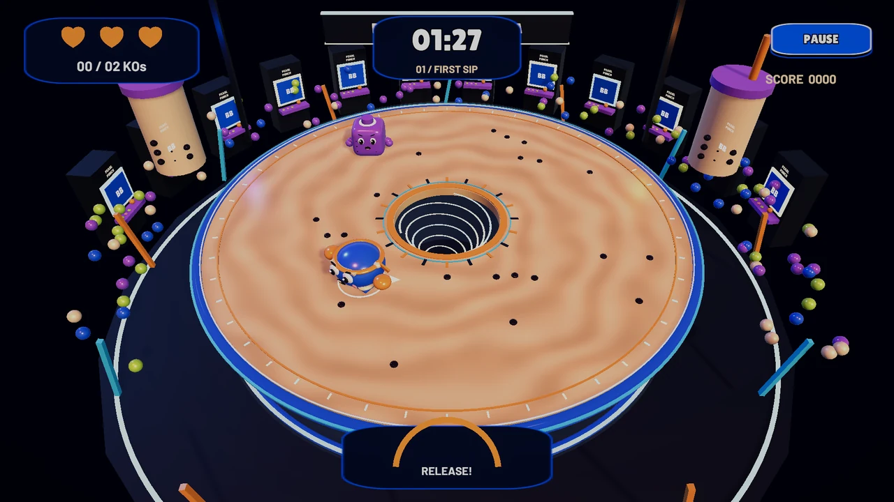
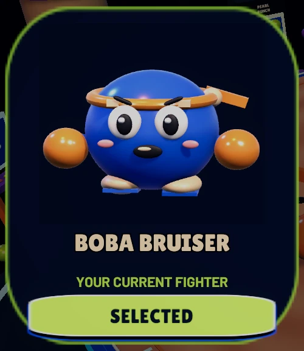
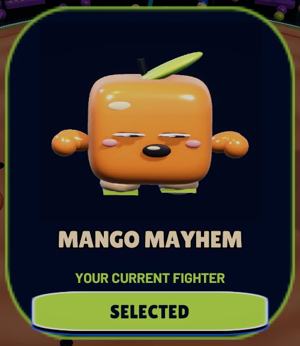
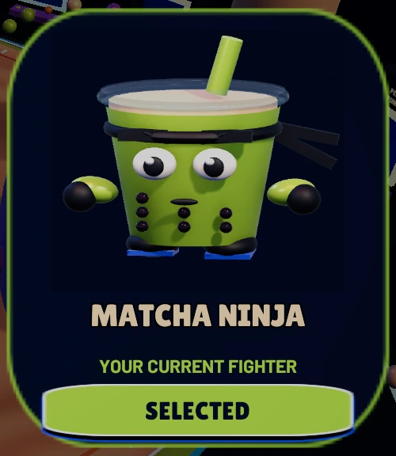
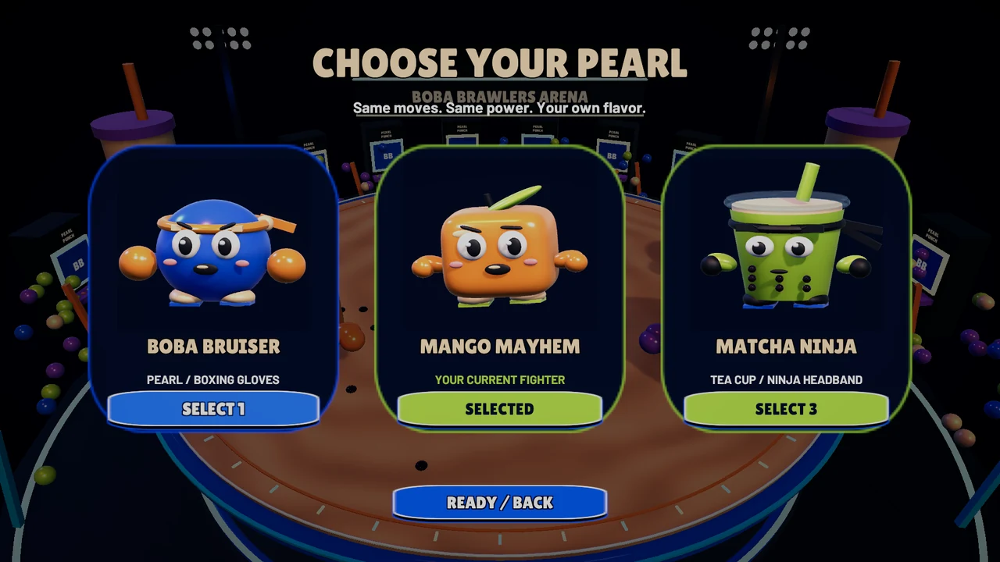
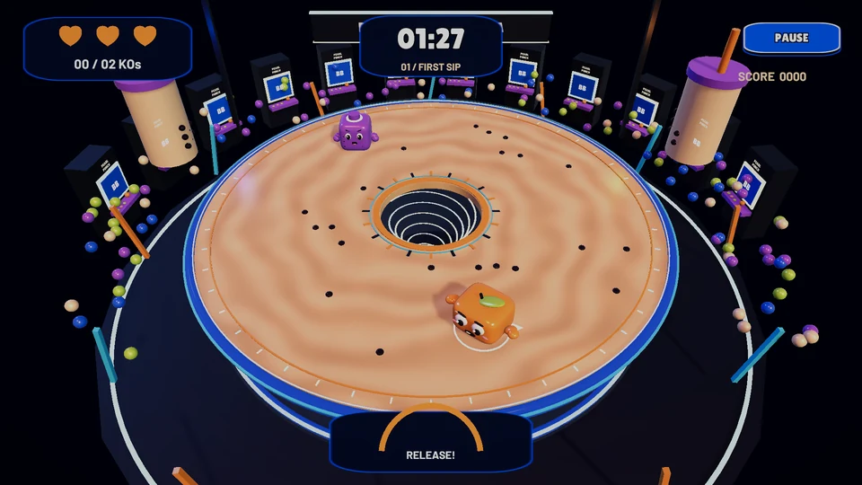
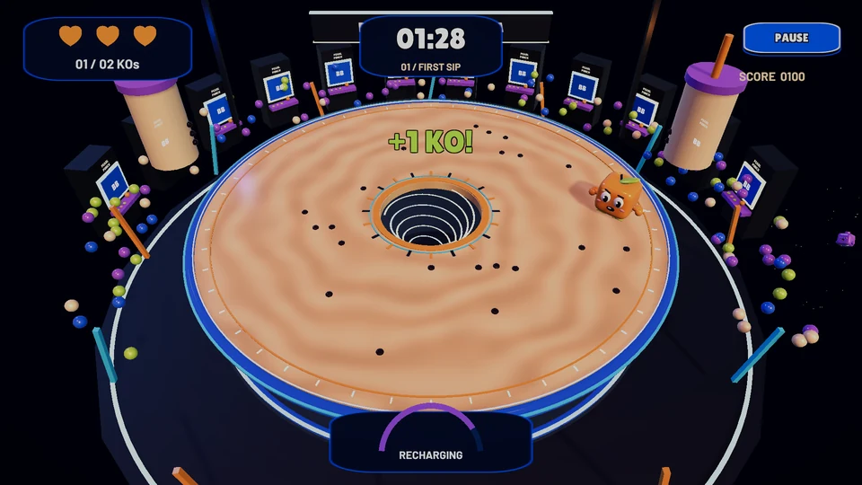
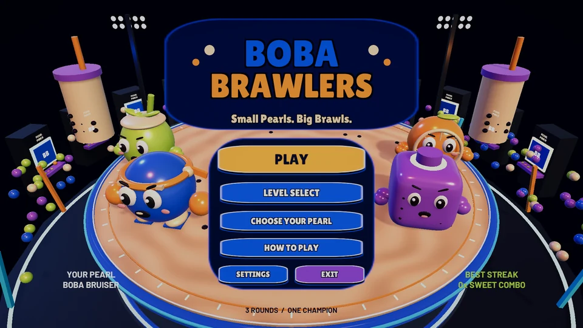
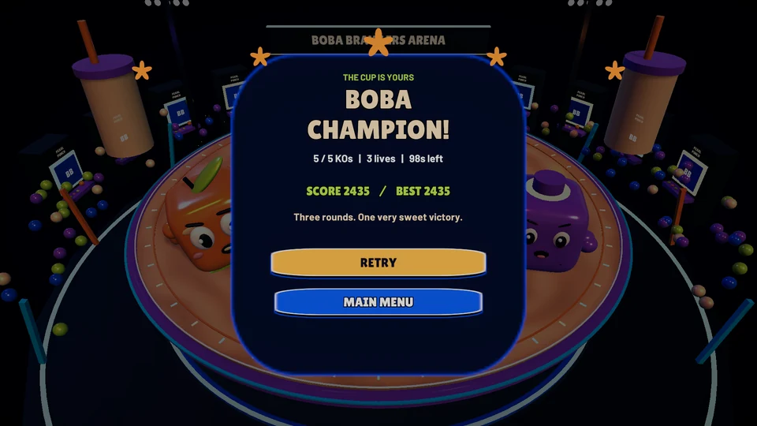

# BOBA BRAWLERS

### Small Pearls. Big Brawls.



A single-player **Unity 3D arcade brawler for Windows**. Charge a dash, line up a hit and push rival ingredients into the swirling center or over the edge of a giant boba bowl. Three rounds turn a simple push mechanic into a fight over timing, space and risk.

[How it works](docs/TECHNICAL.md) · [Opening and playing](docs/SETUP.md) · [Verification](docs/TESTING.md) · [Release draft](docs/releases/v1.0.0.md)

> **Publication status:** source is prepared locally; no release is published. The supplied FAHHH recording has unconfirmed redistribution rights and is excluded from Git. The existing Windows package and voiced video remain local pending clearance. See [asset notices](THIRD_PARTY_NOTICES.md).

## The brawl

- **Hold, aim, release.** Charge a directional dash, send an opponent flying, then recover before the next attack.
- **Two ways out.** The center is a real open hole; the outer rim permits physical ring-outs.
- **Three hearts, one target.** Earn credited KOs before time runs out. Safe respawns give a brief protected return.
- **AI that fights for space.** Rivals route around the hole, avoid obstacles, separate and telegraph charged attacks.
- **A little arcade personality.** Squash/stretch, dash ribbons, star impacts, falling echoes, music and victory confetti.
- **Saved progress.** Unlock rounds, keep best scores and select a character. Music, SFX, fullscreen, shake and reduced motion are configurable.

## Pick your flavor

| Boba Bruiser | Mango Mayhem | Matcha Ninja |
| :---: | :---: | :---: |
|  |  |  |
| Energetic pearl, sporty headband and boxing gloves. Bounce, punch and celebrate. | Squishy jelly cube, mango leaf and mischievous expression. Wobble, stretch and wiggle. | Tapered tea cup, clear lid, straw and ninja ribbons. Side sway, dash lean and victory salute. |

These are separate **3D visual rigs**, sharing one tested player controller, Rigidbody and sphere hitbox. All three have identical movement and dash statistics. The selection screen renders live previews of the playable models; selection persists through respawn, restart and level changes. Character images above are crops from genuine selection screenshots.



## Three rounds

| Round | Rivals | KO target | Timer | Progression |
| --- | ---: | ---: | ---: | --- |
| First Sip | 1 | 2 | 90 s | Easy taro rival; learn timing and ring-outs |
| Sugar Rush | 2 | 3 | 90 s | Faster taro/matcha rivals; one ice bumper |
| Final Brawl | 3 | 5 | 100 s | Hard taro/matcha/mango rivals; two ice bumpers |

Each round starts with three hearts. A recent player hit must cause an enemy fall to earn credit. Wins unlock the next round; the final win earns the cup. Streak bonuses and remaining-heart/time bonuses add to local best scores.

## Controls

| Input | Action |
| --- | --- |
| WASD / arrow keys | Move and aim |
| Hold Space | Charge dash |
| Release Space | Dash in the chosen direction |
| Escape | Pause / resume |
| Mouse or keyboard menu navigation | Choose and activate menu controls |

The floor arrow identifies your aim. The curved meter changes to orange at full charge. A cooldown keeps repeated attacks deliberate.

## In-game screenshots

| Charge your dash | Send a rival out |
| :---: | :---: |
|  |  |

| Main menu | Take the cup |
| :---: | :---: |
|  |  |

All images are genuine Unity scene/Canvas captures, proportionally resized or cropped and encoded as WebP. Nine images total about **0.51 MB**; [provenance](docs/media/provenance.json) records their source captures. Raw frames and the full QA folder are excluded from Git. A 75.7-second, 30 FPS staged gameplay demonstration is prepared locally for a future release; an additional silent copy excludes the uncleared recording.

## Built with Unity and C#

**Unity 6000.6.6f1 · URP 17.6.0 · Input System 1.20.0 · uGUI 2.6.0**

Rigidbody movement and continuous collision drive combat. Reusable C# components separate input, fighter physics, charged dash, AI, match flow, presentation and UI. ScriptableObject level definitions configure enemy count, timing and arena variations. Custom procedural meshes form the three player silhouettes; visual animation never changes their shared hitbox. Live render textures power character previews, while pooled particles and scene-owned audio sources handle feedback.

See the [technical guide](docs/TECHNICAL.md) for verified script paths and implementation details.

```text
Assets/
  BobaBrawlers/
    Scenes/          BobaArena.unity
    Scripts/         Gameplay, AI, UI, presentation and opt-in verification
    Editor/          Existing-scene authoring and Windows build tools
    Prefabs/         Shared player root and ingredient opponents
    Levels/          Three ScriptableObject round definitions
    Resources/       Original audio, UI shapes and licensed fonts
    Materials/       Arena, fighter and particle materials
    Meshes/          Procedural arena and character geometry
  Settings/          URP assets and volume profiles
Packages/            Dependency manifest and lockfile
ProjectSettings/     Unity project and build settings
docs/                Technical guide, setup, testing, release draft and media
Tools/               Original sound generator and repository audit
```

## Open the project or play on Windows

**Developers:** clone the approved source, add its root folder in Unity Hub using **6000.6.6f1**, then open `Assets/BobaBrawlers/Scenes/BobaArena.unity` and enter Play Mode. Unity restores packages and generates its own Library cache. The reaction clip is intentionally absent from a clean Git copy; other assets, music and gameplay remain present. [Setup](docs/SETUP.md) explains the optional licensed audio assignment and building the saved scene.

**Players:** when a cleared Windows release is published, download its ZIP, extract the entire folder and run `BobaBrawlers.exe`. Keep the adjacent data folders and DLLs together. Unity is not required to play. No download is advertised before a release exists; [installation details and current release hold](docs/releases/v1.0.0.md) are documented.

## Testing

The completed local game previously passed **102/102 integration checks** in both the Windows executable and a freshly extracted Windows ZIP, with zero recorded Unity runtime errors/warnings. Actual Editor Play Mode also passed. Coverage includes all three characters, real physics falls/contact, attribution, AI, progression, UI, resolution changes and actual reaction-audio output/muting.

These are recorded results from the full local game, including the supplied clip, **not a claim that every audio assertion passes in the rights-filtered Git copy**. Repository preparation does not rebuild or alter gameplay. The [testing guide](docs/TESTING.md) separates those results from fresh repository and clean-import checks.

## Credits and limits

Original procedural models, tea texture, UI shapes, music and synthesized effects were authored for this project. **Lilita One** and **Barlow Bold** are distributed with their SIL Open Font License notices. Unity starter/template content and runtime/package dependencies retain their respective terms. See [third-party notices](THIRD_PARTY_NOTICES.md).

The artwork is a practical procedural interpretation of the reference direction. Play is local and single-player. Automated staging is not human playtesting; host-specific performance measurements are not a hardware-wide guarantee. The FAHHH recording's rights must be cleared before publishing it, the current voiced video or the current Windows binary. No blanket open-source license is granted by this repository; an overall source license has not yet been selected.
